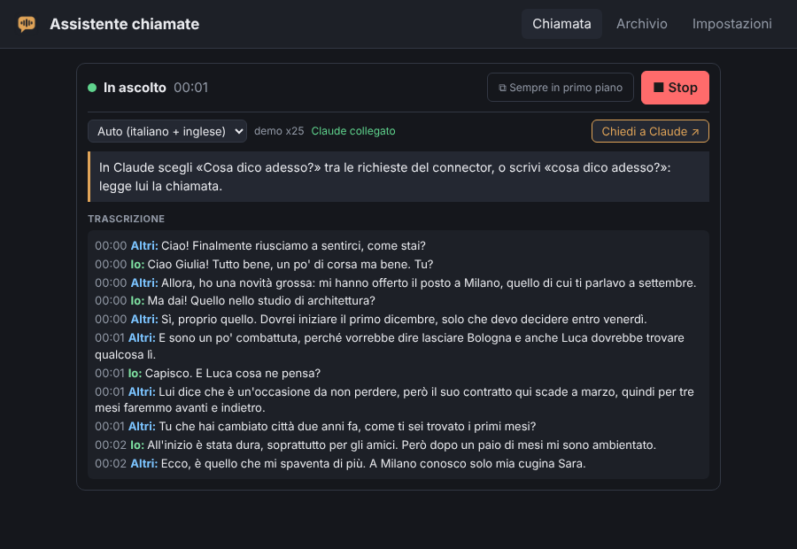
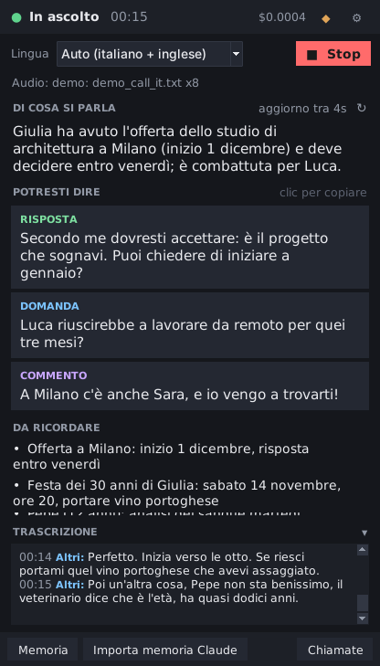
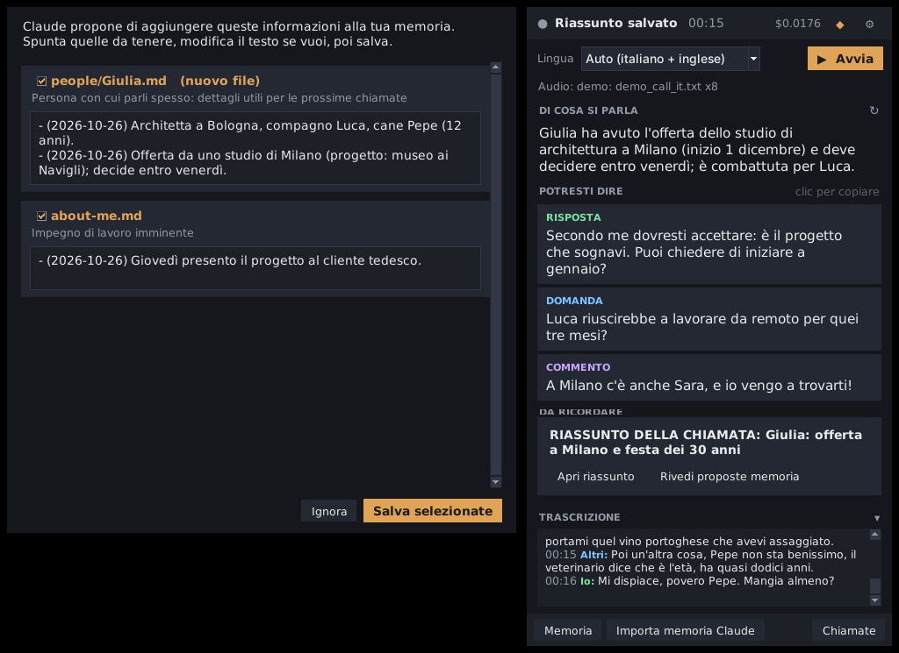
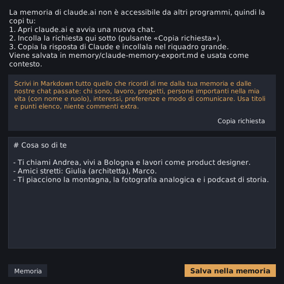

# Call Assistant

A personal assistant for your calls and videos, in the spirit of Proactor.ai but built on **Claude**. You use it from your own Claude chat: no API key, nothing to install.

- **It listens and writes down.** A web page hears your microphone and the call's audio (the tab or screen you share), and transcribes it in your browser with Whisper, in Italian and English. The audio never leaves your computer.
- **Claude reads the call.** The page sends the transcript to your own small bridge on Cloudflare (free). Claude reads it from there, as a **connector** on claude.ai.
- **You ask in the chat.** During the call, pick **«Cosa dico adesso?»** among the connector's prompts, or simply ask «what should I say now?» or «what did they just ask me?». After the call, ask for the summary. Claude answers on your Claude plan, and knows you from your Claude memory.

<p align="center">
  
</p>

> The screenshots come from demo mode (a made-up call) rendered by the real app.

## Contents

0. [Web app with Claude](#0-web-app-with-claude) (recommended)
   - [Set it up (once)](#set-it-up-once)
   - [Use it during a call](#use-it-during-a-call)
   - [Without the bridge: Ask Claude](#without-the-bridge-ask-claude)
   - [Privacy and limits](#privacy-and-limits)
1. [Windows app: install](#1-install-step-by-step) (optional, uses an Anthropic API key)
2. [Windows app: use it during a call](#2-use-it-during-a-call)
3. [Windows app: try it without a call](#3-try-it-without-a-call-demo)
4. [Windows app: your personal memory](#4-your-personal-memory)
5. [Windows app: where your files are](#5-where-your-files-are)
6. [Windows app: costs](#6-costs)
7. [Windows app: privacy](#7-privacy)
8. [Windows app: settings](#8-settings)
9. [Windows app: troubleshooting](#9-troubleshooting)
10. [How it works (for developers)](#10-how-it-works-for-developers)
11. [Credits and licenses](#11-credits-and-licenses)

---

## 0. Web app with Claude

The app and its bridge to Claude are one Cloudflare Worker, made from this repository: the page at `/`, the bridge under `/api` and `/mcp`. Because they share the address, the page connects to its bridge by itself.

### Set it up (once)

About 10 minutes. You can do it from any computer, for example at home.

You need:
- **A Claude plan that allows custom connectors.**
  - On a personal **Pro** or **Max** plan you add it yourself.
  - The **Free** plan allows one custom connector, in beta.
  - On **Team** or **Enterprise**, only an Owner can add it.
- **Accounts:** a **GitHub** account with this repository in it (use **Fork** if it isn't yours), and a free **Cloudflare** account.

1. **Publish the app and the bridge.**
   1. On Cloudflare, go to **Workers & Pages → Create → Import a repository**.
   2. Connect GitHub, pick the repository and press **Deploy**. Nothing else to set: the `wrangler.jsonc` at the root of the repository says what to publish, and the first deploy also creates the database.
   3. Copy the address Cloudflare shows, like `https://transcript.<your-name>.workers.dev`. This is **your app's address**: every merge into `main` updates it.
2. **Open the app.** Open that address in **Chrome or Edge on a computer**. The **Call** tab shows *Last step: add the connector on claude.ai* with the **connector address**. Press **Copy address**.
3. **Add the connector in Claude.**
   1. On claude.ai, go to **Settings → Connectors → Add custom connector**.
   2. Name: *Call Assistant*. URL: the connector address. No login is needed.
   3. Back in the app, press **Done**. The Call tab now says *Claude is connected*.

The connector address contains a secret key made by the page and kept in that browser. If you open the app in another browser, or press **Change secret address**, it shows a new address: update the connector on claude.ai with it.

### Use it during a call

1. **Start.** Open your app's address (tip: pin the tab), choose the call's language and press **Start**. Chrome asks what to share:
   - for a call in the browser (Teams on the web, Google Meet…), pick **that tab**;
   - for a desktop app (Teams, Zoom, WhatsApp), pick **Entire screen**;
   - either way, turn on **"Share audio"**;
   - for a call on your phone, put it on speaker and leave only *My microphone* ticked.

   The live panel shows the transcript and *Claude connected*.
2. **Ask Claude.** In a claude.ai chat with the connector on (the tools menu under the message box):
   - pick a ready-made prompt from the connector (the chat's **+** button): **«Cosa dico adesso?»**, **«Cosa mi hanno chiesto?»**, **«Riassumi la chiamata»**. They bring the latest transcript with them, so Claude answers at once;
   - or just write: «cosa dico adesso?», «what did they just ask me?», «what did we decide about the budget?». Claude reads the call with the connector's tools.
3. **Always on top.** **⧉ Always on top** moves the live panel into a small window that stays above the call.
4. **Stop.** Press **Stop** at the end. Then, in Claude, pick **«Riassumi la chiamata»** or ask for a summary. The call is also kept in the app's **History**, where you can download the transcript.

The first time, the Whisper model downloads (about 150 MB for `base`), and the browser keeps it for next time. Some company networks let downloads from Hugging Face through only after a security check in a browser tab; then the page can't download the model by itself. In that case use **Settings → Load the model by hand**:
- click the 7 links, one at a time, so each file downloads in a tab and passes the check: the two large `.onnx` files and five small `.json` files;
- press **Choose the downloaded files** and pick all 7.

They are stored in that browser's cache, so the app finds them there. The status under the button lists what is still missing. Each address (your Worker, GitHub Pages) has its own cache, so load them where you use the app.

**Try it without a call:** press *Try it with a sample call*. The made-up call goes to the bridge too, so you can ask Claude about it.

### Other ways to set it up

- **App on GitHub Pages, bridge alone.** The `web/` folder is also published with GitHub Pages: for this repository at <https://aaddabbo30-bit.github.io/transcript/>. That page isn't served by a bridge, so connect one in **Settings → Connection to Claude**: paste the bridge's address and press **Connect and test**. A bridge alone can be made with this button, which copies the [`bridge/`](bridge/) folder into a new repository of yours:

  [](https://deploy.workers.cloudflare.com/?url=https://github.com/aaddabbo30-bit/transcript/tree/main/bridge)

- **Bridge alone, by hand** (no GitHub), in the Cloudflare dashboard:
  1. **Storage & databases → D1**: create a database named `call-assistant-bridge`.
  2. **Workers & Pages → Create**: start from *Hello World*, name it `call-assistant-bridge` and deploy it.
  3. **Edit code**: replace everything with the content of [`bridge/src/worker.js`](bridge/src/worker.js), then deploy.
  4. In the Worker's **Settings → Bindings**, add a **D1 database** binding: variable name `DB`, database `call-assistant-bridge`.

### Without the bridge: Ask Claude

If the bridge can't be reached (for example a company network that blocks `workers.dev`), the page still works with any Claude chat:
- during the call, **Chiedi a Claude ↗ / Ask Claude ↗** copies the transcript (its last ~12,000 characters) with a ready-made request, and the first time opens claude.ai. Paste (Ctrl+V) and send;
- after **Stop**, **Riassunto con Claude ↗ / Summary with Claude ↗** copies the whole transcript with a request for the summary.

With the bridge connected, the same buttons copy only a short request, since Claude reads the call itself. In **Settings → Claude chat to open** you can put the link of one of your claude.ai Projects, so these chats end up there.

Why not run the whole thing inside Claude, as an artifact? Artifacts on claude.ai can't use the microphone or capture the audio of a tab, and Claude can't switch them on from its side. So the page does the listening, and the Claude chat does the thinking.

### Privacy and limits

- **Audio:** transcribed inside your browser with Whisper (Transformers.js). It never leaves your computer.
- **Transcript:** it goes to your own bridge on Cloudflare, and Claude reads it from there. The bridge keeps calls for 48 hours at most, and only the last 10. **Delete the calls from the bridge** (Settings) removes them at once. The app's **History** keeps them in that browser only.
- **The connector address is a secret:** whoever has it can read your calls. Keep it private; **Change secret address** makes a new one.
- **Company networks:** some block `workers.dev`. The live panel then shows *Bridge to Claude unreachable*; use *Ask Claude* meanwhile.
- **Claude answers when you ask.** It doesn't follow the call by itself: ask again for an update.
- **Tell the people you talk with** that you are transcribing the call.
- **Cloudflare's free limits** are far above what one person's calls use: the page sends at most one update every 6 seconds, and only when the transcript changed.

---

## Windows app (optional)

The sections below are about the Windows app. It listens to everything the PC plays without sharing a tab, and shows live suggestions in its own always-on-top window. It calls the Claude API **with your own API key** (paid per use), and needs Python, so it isn't for locked-down company PCs. The web app above needs none of this.

<p align="center">
  
</p>

## 1. Install (step by step)

You need **Windows 10 or 11 (64-bit)** and an internet connection. No programming knowledge is required. Installing takes about 5–10 minutes.

### Step 1: get an Anthropic API key

The live suggestions come from Claude through the Anthropic API, which is billed separately from a claude.ai subscription.

1. Go to <https://console.anthropic.com> and sign in (or create an account).
2. Open **Billing** and add some credit (a few dollars lasts a long time, see [Costs](#6-costs)).
3. Open **API Keys** → **Create Key**, give it a name (e.g. `call-assistant`) and **copy** the key. It starts with `sk-ant-`.

Keep the key private. The installer stores it as a Windows *user environment variable* (`ANTHROPIC_API_KEY`); it is never written into the program's files.

### Step 2: download the program

1. On this GitHub page click **Code** → **Download ZIP**.
2. Right-click the ZIP → **Extract All…** and pick a simple folder, for example `C:\Users\<your name>\CallAssistant`.
   Avoid folders synced by OneDrive (such as Desktop or Documents when OneDrive is on): the program creates thousands of small files there.

### Step 3: run the installer

1. In the extracted folder, **double-click `Installa.bat`**.
   If Windows shows a security warning (*"Windows protected your PC"* or *"Open File – Security Warning"*), click **More info** → **Run anyway** (or **Run**). It appears because the file comes from the internet; it is a plain script you can open with Notepad to read. The installer then removes this mark from the program's files so it won't ask again.
2. A blue/black window opens and:
   - finds a 64-bit Python 3.10–3.13, or installs **Python 3.12** for your user only (via `winget`, or from python.org). On Windows-on-ARM laptops it uses the x64 version, which Windows runs transparently;
   - creates a private environment in the `.venv` folder and installs the libraries;
   - if the **Microsoft Visual C++ runtime** is missing (rare, mostly on freshly installed PCs), installs it: Windows asks for administrator permission once;
   - asks for your **API key**: paste it with right-click (nothing is shown while you paste, that's normal) and press Enter;
   - asks which **Whisper model** to download: `1` base (older PCs), `2` small (**recommended**), `3` medium (fast PCs);
   - creates the **"Avvia assistente"** icon on your Desktop, and a **Call Assistant** folder in the Start menu with a shortcut for every tool:

     | Shortcut | What it does |
     |---|---|
     | **Avvia assistente** | opens the assistant window (the one to use for calls) |
     | **Prova demo** | replays a sample conversation, to try it without a call |
     | **Verifica installazione** | checks Whisper, the API key and the audio devices |
     | **Memoria** | opens your personal memory folder |
     | **Chiamate** | opens the folder with your call summaries and transcripts |
     | **Disinstalla** | removes the program (your data is kept) |
3. At the end it offers to start the assistant.

You can run `Installa.bat` again at any time: it repairs or updates the installation without losing anything.

### Step 4 (optional): check everything works

Double-click **`Verifica installazione.bat`**. It checks Python, the Whisper model and the API key, then records 5 seconds: say something and play a video while it records. It prints the level of the microphone and of the PC audio.

---

## 2. Use it during a call

1. **Wear headphones** if you can. Without them your microphone also hears the other people through the speakers; the app removes most of these echoes, but headphones give a cleaner transcript.
2. Double-click **"Avvia assistente"** on the Desktop (or Start menu → *Call Assistant* → *Avvia assistente*). Tip: right-click the icon → *Pin to taskbar* to have it one click away. The window opens at the top-right of the screen and stays above other windows (the ◆ button turns that off).
3. Pick the **language** of the call: *Auto (Italian + English)*, *Italiano* or *English*. You can change it during the call.
4. Press **▶ Avvia (Start)** when the call begins. Works with any app: WhatsApp, Teams, Zoom, Meet, FaceTime on the web, YouTube…
5. The window shows:
   - **DI COSA SI PARLA / WHAT'S BEING DISCUSSED**: the current topic;
   - **POTRESTI DIRE / YOU COULD SAY**: up to 3 suggestions, tagged *Answer*, *Question* or *Comment*. **Click** one to copy it;
   - **DA RICORDARE / TO REMEMBER**: the key facts so far;
   - **TRASCRIZIONE / TRANSCRIPT**: the live transcript ("Io/Me" = your microphone, "Altri/Them" = the PC audio). Click ▾ to hide it.
   - At the top: elapsed time and the **estimated cost** so far (hover it for details). The ↻ button asks for an update right away.
6. Press **■ Stop** at the end. The app finishes transcribing, writes the summary and opens a window with the **memory proposals**: tick the ones to keep, edit the text if you like, and press **Save selected**.

The first suggestions appear about 25 seconds after people start talking.

<p align="center">
  
</p>

---

## 3. Try it without a call (demo)

Double-click **`Prova demo.bat`**, then press **Start**: the window replays a short made-up conversation (`samples/demo_call_it.txt`) as if it were a live call, with real Claude suggestions if your API key is set (it costs a fraction of a cent for the live part and a few cents for the final summary).

From a terminal in the program folder you can also run:

```bat
.venv\Scripts\python -m call_assistant --demo                      :: sample call, real Claude
.venv\Scripts\python -m call_assistant --demo --fake-llm           :: fully offline, scripted answers
.venv\Scripts\python -m call_assistant --demo samples\demo_call_en.txt --speed 2
.venv\Scripts\python -m call_assistant --audio-file recording.wav  :: a WAV recording through Whisper
```

You can write your own transcript to replay: one line per sentence, like `[00:05] Giulia: Ciao!` (`Io`/`Me` means you).

---

## 4. Your personal memory

Claude uses these files as background about you, so suggestions can be specific ("ask Giulia how Pepe's tests went").

```
Documents\Call Assistant\memory\
  about-me.md               who you are: work, family, projects, how you like to talk
  interests.md              hobbies, passions, what you're reading or learning
  people\Giulia Bianchi.md  one file per person you talk with
  claude-memory-export.md   what you pasted from claude.ai
```

- Click **Memoria / Memory** in the window to open the folder, and edit the files with Notepad. Text inside `<!-- ... -->` comments is ignored. Any other `.md` file you add is used too.
- Everything is plain text: you can read, change or delete anything at any time.

### Import your Claude memory

claude.ai's memory can't be read by other programs, so you copy it over once (and again whenever you like):

1. Click **Importa memoria Claude / Import Claude memory** in the window.
2. Click **Copy request** and paste it into a **new chat on claude.ai**. The request asks Claude to write out, in Markdown, everything it remembers about you.
3. Copy Claude's answer, paste it into the big box and press **Save to memory**. It is appended to `claude-memory-export.md` with the date.

<p align="center">
  
</p>

### How the memory grows

At the end of each call Claude proposes **additions** (for example a new `people/Anna Rossi.md`, or new facts in `about-me.md`). Nothing is written until you approve it, existing text is never deleted (additions are appended with a date), and file paths are checked so nothing can be written outside the memory folder.

---

## 5. Where your files are

Everything you own lives in **`Documents\Call Assistant`**:

| Path | What |
|---|---|
| `memory\` | your personal memory (see above) |
| `calls\<date-time>\summary.md` | title, summary, key points, to-dos, notes and memory proposals |
| `calls\<date-time>\transcript.md` | the full transcript (written live, so it survives a crash) |
| `calls\<date-time>\insights.jsonl` | every live update, with its cost |
| `calls\<date-time>\summary.json` | the same summary as data, plus which memory proposals you applied |
| `calls\index.md` | a list of all your calls with links |
| `settings.json` | your settings |
| `logs\app.log` | technical log, useful when something goes wrong |

The program folder only contains the app, its `.venv` and the Whisper model (`models\`). Deleting it does not touch your data.

---

## 6. Costs

Transcription runs on your computer and is free. Claude is billed per token by Anthropic:

| What | Model | When |
|---|---|---|
| Live suggestions | `claude-haiku-5-5` (fast and cheap), low effort | every ~25 s while people talk |
| Final summary + memory proposals | `claude-opus-5-5` (best quality) | once, when you press Stop |

The system prompt (instructions + your memory) is identical for every live update, so it uses **prompt caching** and costs about a tenth of the normal price after the first update.

As a rough guide, a **30-minute call costs around 10–20 US cents**, most of it for the final summary; the live suggestions are a few cents. The window shows a running **estimate** (hover the amount for the split between live and summary), and `summary.md` records the total. Your actual bill is on console.anthropic.com. To spend even less, set `"summary_model": "claude-haiku-5-5"` in `settings.json`.

The prices used for the estimate are in `settings.json` (`pricing_usd_per_million_tokens`); update them if Anthropic's prices change (<https://claude.com/pricing>).

---

## 7. Privacy

- **Audio never leaves your computer**: Whisper runs locally. Only the **text** of the transcript and your memory files are sent to the Anthropic API to produce suggestions and the summary. See Anthropic's commercial terms and privacy policy for how API data is handled.
- Your API key is stored as a Windows user environment variable, not in any file of the program.
- Memory, transcripts and summaries are plain files in your Documents folder.
- **Tell the people you're talking with** that you're transcribing the call, and follow the law where you live.
- The window is visible to others if you share your **entire screen**. Share a single window instead.

---

## 8. Settings

Click **⚙** in the window to change the interface language, the Whisper model, how often suggestions refresh, and which audio sources to use, or to enter a new API key. Everything is also in `Documents\Call Assistant\settings.json`:

| Key | Default | Meaning |
|---|---|---|
| `ui_language` | `"it"` | interface language and language of summaries (`"it"` or `"en"`) |
| `call_language` | `"auto"` | `"auto"` (Italian or English), `"it"` or `"en"` |
| `capture_microphone` / `capture_system_audio` | `true` | which sources to listen to |
| `microphone_device` / `speaker_device` | `""` | part of a device name (e.g. `"Headset"`); empty = Windows default |
| `whisper_model` | `"small"` | `tiny`, `base`, `small`, `medium`, `large-v3-turbo` |
| `whisper_device` / `whisper_compute_type` | `"cpu"` / `"int8"` | use `"cuda"` / `"float16"` with an NVIDIA GPU (needs CUDA 12 + cuDNN 9) |
| `insight_model` / `insight_effort` | `"claude-haiku-5-5"` / `"low"` | model for live suggestions |
| `insight_interval_seconds` | `25` | seconds between updates (10–120) |
| `insight_transcript_window_seconds` | `240` | how much recent transcript each update sees |
| `summary_model` / `summary_effort` | `"claude-opus-5-5"` / `"medium"` | model for the final summary |

---

## 9. Troubleshooting

| Problem | Fix |
|---|---|
| Nothing appears under "Altri / Them" (the window warns you after ~45 s) | The app records the **default playback device**. Call apps (Teams, Zoom, WhatsApp) often play on the *default communication device* instead, and Bluetooth headsets switch to a separate "Hands-Free" device during calls. Make that device the Windows default (Sound settings), choose it in the call app, or type part of its name in ⚙ Settings → *Audio output*. `Verifica installazione.bat` and `.venv\Scripts\python -m call_assistant --list-devices` show the device names. |
| Nothing appears under "Io / Me" | Check the microphone in Windows privacy settings (*Let desktop apps access your microphone*), and that it's the default input device, or set `microphone_device`. |
| The same sentence appears twice | Use headphones. Most echoes are removed automatically. |
| "Your PC can't keep up…" | Choose the `base` model in ⚙ Settings. |
| "API key not valid" or "credit balance too low" | Check the key and the credit on console.anthropic.com; enter a new key from ⚙ → *API key…*. |
| The window doesn't open | Run `Verifica installazione.bat`, and look at `Documents\Call Assistant\logs\app.log` (or `%LOCALAPPDATA%\Call Assistant\logs` if Documents isn't writable). Running `Installa.bat` again repairs most problems. |
| "Le librerie non si avviano / libraries don't start" during install | Install the [Microsoft Visual C++ runtime](https://aka.ms/vs/17/release/vc_redist.x64.exe), restart the PC and run `Installa.bat` again. |
| A device was plugged in or out during the call | Press Stop and Start again: the app picks the devices when a call starts. |
| Wrong language in the transcript | Pick the exact language instead of *Auto*. |

To uninstall: close the assistant, double-click **`Disinstalla.bat`**, then delete the program folder. Your data in `Documents\Call Assistant` is kept.

---

## 10. How it works (for developers)

```
 microphone ─┐   WASAPI (PyAudioWPatch)                         faster-whisper (local, CPU)
             ├─► 16 kHz mono ─► per-source segmenter ─► queue ─► transcription ─► transcript store ─┐
 PC audio  ──┘   loopback        (cuts at pauses)                 IT/EN, VAD,      (echo removal)     │
                                                                  hallucination filter               │
                                                                                                      ▼
   memory/*.md ──► system prompt (cached) ──► Claude Haiku 5.5, every ~25 s ──► Tk overlay (always on top)
                                                    │
                     Stop ──► Claude Opus 5.5 ──► summary.md + memory proposals ──► you approve ──► memory/*.md
```

- **Python 3.10+**, standard **Tkinter** for the window (no extra GUI dependency).
- `call_assistant/capture_windows.py`: microphone + speaker loopback with [PyAudioWPatch](https://github.com/s0d3s/PyAudioWPatch) (no "Stereo Mix" or virtual cable needed). Same approach as [ecoute](https://github.com/SevaSk/ecoute).
- `audio.py`: conversion, resampling, an energy-based utterance segmenter with an adaptive noise floor, stale-utterance flushing (WASAPI loopback sends nothing during silence), WAV playback for tests.
- `transcriber.py`: [faster-whisper](https://github.com/SYSTRAN/faster-whisper) with its built-in Silero VAD filter, Italian/English-only auto-detection, and filters for Whisper's typical hallucinations ("Sottotitoli creati dalla comunità Amara.org", "Thanks for watching") and repetition loops.
- `transcript.py`: ordered, thread-safe transcript; drops microphone echoes of the PC audio.
- `insights.py`, `summary.py`, `prompts.py`, `llm.py`: Claude via the official [`anthropic`](https://github.com/anthropics/anthropic-sdk-python) SDK, with **structured outputs** (JSON schema), **prompt caching** of the instructions + memory, per-request **cost estimate**, readable error messages, and server-side refusal **fallbacks** (`fallbacks: "default"`) for the summary model.
- `memory.py`: Markdown memory, Claude-export import, validated append-only updates.
- `session.py`: one call from Start to Stop; worker threads talk to the UI through an event queue.
- `ui/`: overlay window and dialogs. `simulate.py`: transcript replay for the demo.

### Web app (`web/`)

The web app needs no build step: plain ES modules, served as static files. It never calls the Claude API: Claude reads the call from the bridge, or from what *Ask Claude* copies.
- `js/segmenter.js` and `js/transcript.js` port the desktop logic: segmentation, filters, echo removal.
- `js/audio.js` and `js/audio-worklet.js`: microphone and shared tab/screen audio through an AudioWorklet.
- `js/whisper-worker.js`: Whisper in a Web Worker with [Transformers.js](https://github.com/huggingface/transformers.js), WebGPU with a WASM fallback, loaded from jsDelivr. `js/model-files.js` loads the model by hand.
- `js/session.js`: the call, from Start to Stop.
- `js/bridge.js`: finds the bridge at the page's own address, or at the one given in Settings, and sends it the running call.
- `js/prompts.js`: the requests that *Ask Claude* copies for a claude.ai chat.
- `js/history.js`: past calls, in the browser's local storage.

After changing anything in `js/` or `css/`, run `node web/tools/stamp.mjs`. It writes a hash of those files into `index.html` (`?v=…` links plus an import map), so browsers fetch a new version as a whole instead of mixing new and cached files. CI fails when the stamp is out of date.

Run it locally with any static server, for example `python -m http.server -d web`, then open <http://localhost:8000>; `localhost` counts as secure for the microphone. With the bridge too: `npx wrangler dev` at the root of the repository serves both, with a local database.

Tests:
- `node --test web/tests/unit.test.mjs` runs 15 unit tests: segmentation on a real recording, filters, echo removal, full simulated calls, the chat requests, the bridge client.
- `node web/tests/e2e.mjs` runs Chromium with a fake microphone playing a speech recording. It covers:
  - the app served by its bridge: it connects by itself, shows the connector step, and Claude's side reads the call over MCP;
  - a bridge at another address, connected in Settings;
  - *Ask Claude* without a bridge, the end of a call, the history and the transcript download;
  - the always-on-top window, the model loaded by hand, and the version stamp of every script, including the Whisper worker.

  It needs `playwright`.

### Claude bridge (`bridge/`)

A Cloudflare Worker with no dependencies, [`bridge/src/worker.js`](bridge/src/worker.js). It has three sides:
- **For the page:** `POST /api/<key>/call` saves the current call, `GET /api/<key>/status` checks the bridge, and `POST /api/<key>/delete` clears the calls.
- **For Claude:** `POST /mcp/<key>` is an MCP server over Streamable HTTP, with JSON responses and no login.
  - Three read-only tools: `get_current_call`, `list_calls` and `get_call`.
  - Three prompts that carry the transcript: `cosa_dico_adesso`, `cosa_mi_hanno_chiesto` and `riassunto_chiamata`.
  - When the Worker also serves the app, its answers include the app's address, so Claude can give the user the link.
- **The app itself:** with the root [`wrangler.jsonc`](wrangler.jsonc), `web/` is published as static assets of the same Worker (`/web/…` links redirect to `/…`); `bridge/wrangler.jsonc` publishes the bridge alone.

Storage is D1, bound as `DB`. The table is created on the first request; the database is created by the first deploy. `<key>` is a random 32-character secret made by the page; the database stores only its SHA-256.

Tests:
- `node --test bridge/test/*.test.mjs` runs the Worker against Node's built-in SQLite.
- `node bridge/test/mcp-client.mjs [url]` connects with the official MCP TypeScript SDK client: tools and prompts. Without a URL it runs the Worker in-process; with one it uses a running bridge, such as `npx wrangler dev`.
- CI runs all of these, including `wrangler dev` with a local D1 database and deploy dry runs of both configurations.

### Run from source

```bash
python -m venv .venv && .venv/bin/pip install -r requirements-dev.txt   # Windows: .venv\Scripts\...
python -m pytest                       # on Linux the window tests need a display: xvfb-run -a python -m pytest
python -m call_assistant --demo --fake-llm             # the window, fully offline
python -m call_assistant --headless --demo --fake-llm --speed 20   # no window, prints events
python -m call_assistant --check | --list-devices | --download-model small
```

### What is tested, and what isn't

This project was built in a cloud environment without a sound card, without Windows and without access to the Whisper model downloads. So:

- **Tested automatically** (81 tests): resampling (including 48 kHz stereo, like WASAPI loopback), segmentation on synthetic signals and on real synthesized Italian/English speech, the Whisper wrapper (with a stand-in model: language handling, CPU fallback, hallucination filters), transcript echo removal, the real `anthropic` SDK request/response path against a mocked HTTP server (request shape, caching, structured outputs, fallbacks, errors), cost estimates, memory (templates, import, path validation, approvals), full simulated calls from transcript and from audio, and the real Tk window under a virtual display (start, live updates, click-to-copy, stop, summary, memory approval).
- **CI on GitHub Actions** (`.github/workflows/ci.yml`) runs the tests on Linux and Windows and runs `install.ps1` non-interactively on a Windows runner.
- **Reviewed, not executed**: the Windows-only code (installer, WASAPI capture, registry and shortcut code) was checked line by line against the PyAudioWPatch source and Windows PowerShell 5.1 rules.
- **Needs a real Windows PC to verify**: live capture from your microphone and speakers, actual Whisper transcription quality/speed on your hardware, and the desktop shortcut. `Verifica installazione.bat` checks the first two quickly.
- **Web app and bridge**:
  - tested by unit tests, the official MCP client and 7 browser scenarios with a fake microphone (see above);
  - in CI the bridge also runs on Cloudflare's local runtime (`wrangler dev`), alone and together with the app;
  - not covered by tests: claude.ai itself (adding the connector, where its prompts appear) and the deploy on a real Cloudflare account.

---

## 11. Credits and licenses

This project is released under the [MIT License](LICENSE). It builds on open-source work, used as libraries (no code copied):

- [faster-whisper](https://github.com/SYSTRAN/faster-whisper) (MIT), [CTranslate2](https://github.com/OpenNMT/CTranslate2) (MIT), OpenAI [Whisper](https://github.com/openai/whisper) models (MIT), [Silero VAD](https://github.com/snakers4/silero-vad) (MIT, bundled with faster-whisper)
- [PyAudioWPatch](https://github.com/s0d3s/PyAudioWPatch) (MIT, a PyAudio fork with WASAPI loopback) and [PortAudio](http://www.portaudio.com/) (MIT-style)
- [Anthropic Python SDK](https://github.com/anthropics/anthropic-sdk-python) (Apache-2.0), [NumPy](https://numpy.org) (BSD-3-Clause)
- Web app: [Transformers.js](https://github.com/huggingface/transformers.js) (Apache-2.0, loaded from jsDelivr) running the [onnx-community Whisper](https://huggingface.co/onnx-community/whisper-base) models (MIT)
- The microphone + speaker loopback design was inspired by [ecoute](https://github.com/SevaSk/ecoute) (MIT).

See [THIRD_PARTY_NOTICES.md](THIRD_PARTY_NOTICES.md). Call Assistant is an independent project, not affiliated with Anthropic or Proactor.ai.
